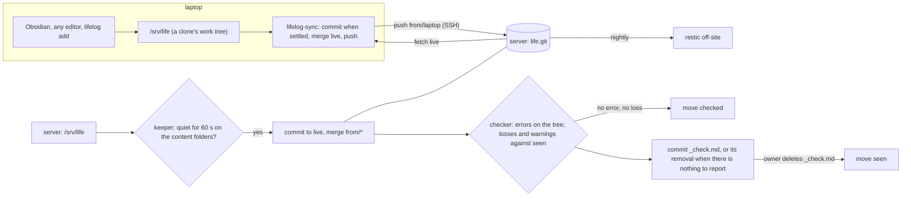
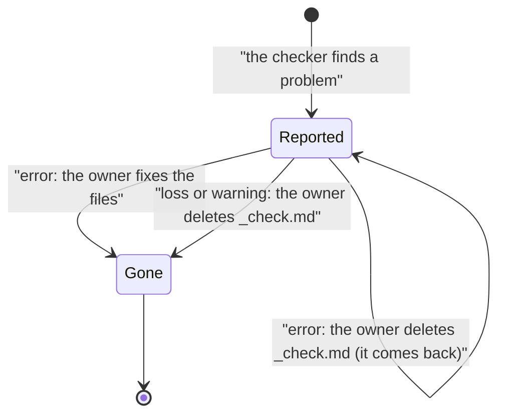

# lifelog — design

lifelog keeps the owner's life log as plain files: markdown pages and CSV readings, with a checked history in git
that also carries the folder between the owner's machines. It replaced aminte (one SQLite file) in the Balaur fleet
on 2026-11-15. It came from an interview, a web research pass, three adversarial reviews and the spikes of
[plan 001](plans/001-spikes.md); [plan 002](plans/002-into-the-fleet.md) brings it into the fleet, and
[plan 005](plans/005-git-sync.md) replaced Syncthing with git on 2026-11-22.

**Machines: the server (the keeper) and the laptop.** Both run NixOS. The phone has no copy of the folder: it opens
the web app on the server ([plan 003](plans/003-the-web-app.md)). The plans before 005 name the machines of their
time: the tablet and the pc were the keeper's machine before the server.

**The idea that keeps it small: git history records what changed.** The keeper commits every settled state, so
the files need no ids and no append-only rows. Git does not record what a change *means*, so a few rules keep
meaning: a loss must be acknowledged, a title of a deleted page is not taken again in silence, and each machine
writes its own readings.

## 1. The model, and the guarantee

- One folder, `/srv/life`, on each machine. On the server it is the work tree of the keeper's history,
  `life.git`; on the laptop it is the work tree of a clone of it. Git over SSH carries it between them (§3).
- Any editor on any machine writes into it. Nothing refuses a write.
- The server runs the **keeper**. It commits each settled state to one branch, `live`, merges what the other
  machines pushed, runs the checker, and keeps two refs:
  - **`checked`**: the newest commit with no error and no unacknowledged loss. **`checked` is the final check.**
  - **`seen`**: the commit the owner last acknowledged. Losses and warnings are computed against `seen`, so they
    stay in `_check.md` until the owner acknowledges them.
- **The owner acknowledges by deleting `_check.md`** on any machine. The keeper then moves `seen` to the commit it
  reported on. An error does not go away by acknowledgement: it comes back until the files are fixed.
- The guarantee: **every settled state is in `live`; `checked` points only to a state with no error and no
  unacknowledged loss; each problem stays reported on every machine until it is fixed or acknowledged.**





## 2. Layout

```
/srv/life/                         the work tree; group lifelog, 2770, a default ACL for the group
  journal/2026-11-14.md            day page: the filename is the day
  pages/  people/  places/         the folder is the kind; a move is only a move
  metrics/weight.md                the metric's page: frontmatter holds unit, min, max, daily
  metrics/weight/2026.laptop.csv   readings of that metric, that year, written on the machine "laptop"
  files/2026/x.md + x.jpg          extracted text + small JPEG; frontmatter: sha256, mime
  _check.md                        committed by the keeper; deleted by the owner to acknowledge
  .lifelog/                        the marker: this is the folder, not an empty directory in its place
/var/lib/lifelog/life.git          on the server: the keeper's git dir, outside the folder
~/.local/share/lifelog/sync.git    on the laptop: the clone's git dir, outside the folder
```

- **The content folders** are `journal/`, `pages/`, `people/`, `places/`, `metrics/` and `files/`. The checker
  reads only them. The quiet window counts changes only in them. `_check.md` and `.obsidian/` are outside them.
- A page's identity is its title, which is its filename. Links are by title (`[[Ferritin]]`). A rename in Obsidian
  rewrites the links; an old name the owner wants to keep goes into `aliases`.
- Each machine appends readings only to its own file; the machine's name is its hostname. Two machines never append
  to one file, so an offline week makes no conflict copy. A correction may edit a line in any machine's file.

## 3. Sync through git

- **The hub is `life.git` on the server.** `live`, `checked` and `seen` are the keeper's, and only the keeper moves
  them, in place. Each other machine pushes to one ref of its own, `from/<host>`. The repository's `update` hook
  refuses any other push, so a client never moves `live` under the server's folder.
- **The laptop, each minute (`lifelog-sync`).** It commits the settled folder to its branch `work`, fetches,
  merges `live` into it (`lifelog integrate`), and pushes `work` to `from/laptop`. Offline, it commits and stops;
  the push goes with the next run that reaches the server. Its commits carry the machine's name (`lifelog laptop`).
- **One merge rule, in Go (`lifelog integrate`)**, used by both sides:
  - What git merges cleanly is merged. Per-machine CSVs (§2) mean readings never conflict.
  - A file both sides changed: the version already in the folder stays, and the other side's goes beside it as
    `<name>.sync-conflict-YYYYMMDD-HHMMSS-<host>.<ext>`. The checker reports it as an error until it is merged (§5).
  - A file one side deleted and the other changed: the changed one stays.
- **Permissions.** The group `lifelog` holds the owner, the keeper's user and the web app's. `life.git` has
  `core.sharedRepository = group`, so what the owner pushes stays writable by the keeper. The folder's default ACL
  keeps what anyone writes in it writable by the group, whatever the writer's umask. The `media` group and the
  household cannot read it.
- A new machine joins with `balaur.lifelog-client.syncWith = "server"` and, once, `lifelog-sync init` into an
  empty `/srv/life`.
- Not Forgejo: it would index the folder and keep a copy in its own state, and it cannot hold a repository with a
  work tree.

## 4. The keeper (server)

1. **Settled** means: no change for 60 seconds in the content folders. The keeper does not wait for machines. A
   writer slower than the window can give a half state ([plan 001](plans/001-spikes.md), S1): `live` records it,
   and the checker reports what it sees. The laptop's `lifelog-sync` uses the same rule before it commits.
2. Commit the settled state to `live`. The git dir's `info/exclude` holds `.lifelog/`, `.syncthing.*.tmp` (the
   writers' temporary files keep Syncthing's name), `.obsidian/`, and `.stversions/` (old versions Syncthing left).
3. Merge each `from/<host>` that `live` does not contain, into `live` and the folder. A merge that git refuses (a
   write landed a moment ago) is tried again at the next run.
4. Run the checker: errors on the tree; losses and warnings against `seen`.
5. No error and no loss: move `checked`.
6. Anything to report: write `_check.md` with each problem: its class, the rule, the path, the reason in words, the
   fix, and the time of the run, and commit it. Nothing to report: remove `_check.md`, commit that, and move `seen`.
7. `_check.md` absent where the keeper wrote one: the owner acknowledged (on the laptop, the deletion arrives by
   the merge). Move `seen` to the commit of that report.
8. **The keeper writes only `_check.md`**, and what the merges bring. It never edits a page or a CSV itself.
9. On the server, `lifelog restore <path> [<ref>]` writes a file back from `checked` (or another ref) into the
   folder. `_check.md` prints the exact line for each loss.

## 5. Writers

- Obsidian, or any editor, on the laptop. On the phone, the web app on the server (`lifelog/web`): it saves a page only if
  nobody changed it since it was opened, adds a note to a day page, and adds readings as the machine `web`
  (`metrics/<m>/<year>.web.csv`). It makes pages with `lifelog new` and reads the folder with `lifelog index`. A reading is a line typed into the machine's CSV, or appended
  by `lifelog add weight 81.4`, which adds a missing final newline first and appends one well-formed line.
  The Balaur agent and the `money` skill write on the server too.
- A correction of a reading is an edit of its line. Git keeps the old value; the checker warns, so it is visible.
- A rename outside Obsidian leaves links to the old name. `lifelog rename-links <old> <new>` rewrites them.
- A conflict copy is merged by the owner. For a CSV, `lifelog merge` compares the lines by their key
  `(day, taken_at, source)`: it adds the lines with a new key, asks about a key with two values (a correction on one
  side, or two readings), and removes the copy. It never reads the machine's name in the copy's name (S3).
- History is read on the server (`life.git`), or in the laptop's clone:
  `git --git-dir ~/.local/share/lifelog/sync.git log`.

## 6. The rules of the checker

Each rule applies only in the content folders.

| class | what it means | rules |
|---|---|---|
| **error** | the state is damaged; `checked` stays until the files are fixed | a YAML block or a CSV file does not parse; a CSV header is not `day,taken_at,value,source`; a day, an instant or a value outside its grammar (no `inf`, no comma); a value outside its metric's `min`..`max`; a CSV whose metric page does not exist; a path that is not NFC, has one of Obsidian's characters (`# ^ [ ] \|`), or is longer than 200 bytes; two pages with one title or alias key; a `*.sync-conflict-*` file; a git conflict marker; a file that is not UTF-8, or mixes CRLF and LF; a `part-of` on a day page; two files with one `sha256`; a file outside the layout of §2 (a folder in `journal/`, a file that is not `.md` in a page folder, anything in `metrics/` or `files/` that §2 does not name); a file in `journal/` not named by a real day; a frontmatter value outside its grammar (`part-of` not a quoted link, a `sha256` not 64 hex digits, a `mime` not a media type, `min`/`max` not numbers or `min` more than `max`, `daily` not `true`/`false`, one key with a list) |
| **loss** | something may be gone; `checked` stays until the owner acknowledges | more than 20 pages deleted since `seen`; a CSV removed; a page emptied |
| **warning** | the state may be wrong; `checked` moves; the report stays until acknowledged | a link that resolved at `seen` no longer resolves; an unresolved `part-of`; a page that lost more than half of its bytes; a new page that takes the title of a page deleted earlier in `live`; a reading changed or removed (a correction); two lines with one key `(day, taken_at, source)` in one metric; a metric's unit changed; a frontmatter key outside the list of its kind; a CSV without a final newline |

- A file with CRLF line endings only is read as LF.
- A broken-link warning says what happened. The checker asks git for the renames between `seen` and `live`
  (`git diff -M`; the keeper sets `diff.renameLimit` high). When the old target was renamed, the warning names the
  new path, the pages that link to the old name, and the fix (`lifelog rename-links`, or an alias). A rename with a
  large rewrite (below git's 50 % similarity) looks like a delete and an add; the warning then names no new path.
- The title-reuse warning reads the titles of deleted paths from `git log -M --diff-filter=D` on `live`, at each run
  that has a new page. A deleted page and a new page at the same path inside one window look like an edit to git,
  so that case is not seen.
- Two titles are one key when they are equal after Unicode case folding, so `Iron` and `iron` cannot both exist.
- The key lists: all kinds `aliases`, `part-of`, `day` (a dated page that is not a day page); people `name`,
  `born`, `died`; files `sha256`, `mime`; metrics `unit`, `min`, `max`, `daily`. Tags live only as `#tag` in a body.
- `taken_at` is empty or one instant with its offset: `2026-11-14T07:02:00+02:00`.

## 7. Time, and the limits of git as the record

- Page frontmatter holds no instant. `day` is a date. A reading has `day` and an optional `taken_at`.
- The commit time of a change is when the folder of the machine that wrote it settled, and the commit names that
  machine. A week written on an offline laptop arrives as that week's commits, and the keeper's merge commit is the
  time of its return.
- Git does not see a state inside one quiet window: a value typed and corrected within 60 seconds leaves no trace of
  the first value.
- Git does not see an edit on the server while the keeper is down, or on the laptop while `lifelog-sync` is not
  running; the next commit holds the sum.
- "What was this reading on a day, as I knew it then" is answered by `git log -p` on the CSV, with these limits.

## 8. The importer from aminte

- `lifelog-import` does it, a binary of its own beside `lifelog` (its SQLite dependency stays out of `lifelog`).
- It read `life-latest.db`, the last nightly snapshot of aminte, never the live file. The import ran once (plan 002);
  the binary stays for a second import from that snapshot.
- It commits each page with its `created_at` as the git author date, so the creation times live in git.
- It commits each tombstoned page and then deletes it, so the title-reuse warning knows the names that aminte held.
- It renames each title that the path rules refuse (for example `C#`) and lists each rename in its report.
- It flattens each reading's correction chain to its current value; the chain stays in the last snapshots of aminte.
- It writes the readings to `<year>.import.csv` files, as the machine "import".

## 9. Backups and privacy

- The `backup` aspect (restic, off-site, in Europe) backs up `/var/lib/lifelog/life.git` on the server, and its
  monthly drill restores it and runs `git fsck`.
- The laptop's clone is a second copy of the whole history, current to its last sync.
- The fleet repo is public. The folder, the git dirs and any copy of them never enter it, nor Forgejo.
- Accepted: deleted pages and replaced pictures stay in git, on the laptop too, and in each backup. `_check.md` is
  plain text in the history.

## 10. What is given up, from aminte

- Append-only readings and their recorded time: corrections are edits; git holds the old values, within the limits
  of §7.
- Stable ids for pages: the title is the identity; a reused title is a warning, not a refusal.
- Refusal of a bad write: errors and losses keep `checked` back; nothing stops the write.
- Full-text search in the file: ripgrep and Obsidian.
- The one-transaction save: a change arrives file by file; the quiet window replaces it.
- The zone name of a reading: the offset in `taken_at` replaces it.
- The API, the CLI's actions and the MCP server of aminte: Obsidian, the web app and the `lifelog` CLI replace them.

## 11. Accepted costs

- A bad file reaches every machine before the check. `live` and `lifelog restore` recover it.
- `checked` can wait days for a fix or an acknowledgement. `live` has no gap while the keeper runs.
- Two machines that edit one page while apart make a conflict copy the owner merges by hand.
- If the keeper is down, nothing is committed or merged; the laptop's commits wait in `from/laptop`; `_check.md`
  shows the time of its last run.
- A laptop edit reaches the server one to two minutes after the typing stops, and only while the laptop reaches it.
  A laptop that never reaches the server holds its commits; `balaur-fleet-status` does not show that yet.
- The keeper's merge writes into the server's folder while the web app or the agent may write there. Git refuses a
  merge over an unsaved change, so the cost is a retry, not a lost write.

## 12. Deferred

- A copy of the folder on the phone; the web app covers the phone for now.
- A client app (Flutter); if it comes, it calls the Go checker through FFI.
- Period pages, until they are used.
- The counts of errors, losses and warnings on the Balaur app's Home page (a status file the keeper writes).
- A laptop's unpushed commits in `balaur-fleet-status`.
