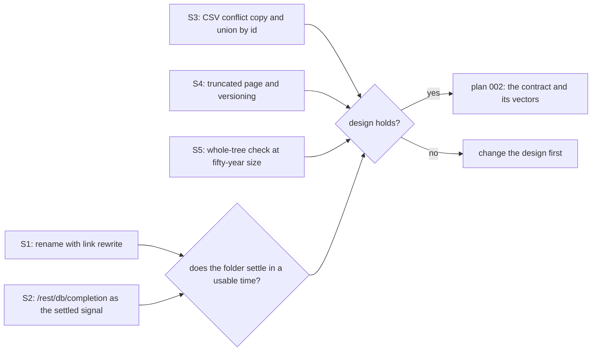
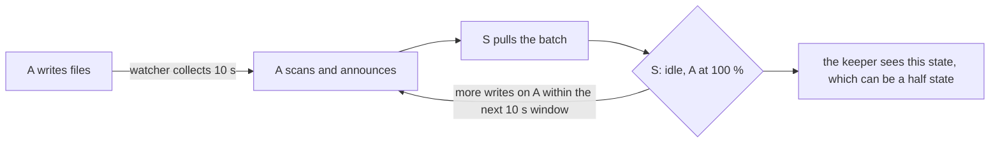

# Plan 001 — spikes before code (2026-11-14)

Each spike tests one risk that can change the [design](../design.md). Each one uses a synthetic folder, never real
data. Record the result in this file: what was run, on which machine and versions, and what was seen.

Phase 1 has no phone. Two or three Syncthing instances on one Linux machine (each with its own `--home` and its own
ports) stand in for the devices. A paused instance stands in for a device that is asleep or offline.

## S1 — a rename with link rewrite

- Setup: a synthetic vault of about 200 pages, one page linked from 30 others. Instance A (a desktop) and
  instance S (the server).
- Steps: on A, rename the linked page and rewrite the 30 links (Obsidian desktop, or a script that writes the files
  one by one with a short pause). Watch S.
- Measure: the time until all 31 files are on S; whether S ever sees the old and the new name at the same time.
- Pass: the files arrive within the keeper's quiet window, or the settled signal of S2 covers the gap.

## S2 — the settled signal

- Steps: start a rename on A, and pause A in the middle (a stand-in for a device that sleeps). On S, read
  `/rest/db/completion` for A, and `/rest/db/status` for the folder.
- Pass: S shows A as behind (below 100 %) while A's changes are not yet sent, and at 100 % after A resumes.
- If it fails: the keeper needs another signal (for example a marker file that each device writes last).

## S3 — a CSV conflict copy

- Steps: pause the link between A and B. Append rows to the same `2026.<device>.csv` on both (break the per-device
  convention on purpose). Resume.
- See: the name and the content of the `*.sync-conflict-*` copy; whether any row is lost or joined.
- Pass: a union by `id` of the two files gives every row once.

## S4 — a truncated page

- Steps: on A, write a zero-byte file over a page; on B, cut another page to half its size.
- See: what trash-can versioning (30 days) keeps on each instance; that the shrink guard can be written from the data
  it has (the tip of `checked`).

## S5 — scale

- Steps: generate a synthetic tree at fifty-year size (about 18 000 day pages, 5 000 pages, 50 metrics with one file
  per year). Time a whole-tree check with a cold cache and with a warm cache (by blob hash).
- Pass: the warm check takes seconds, so the keeper can run it after each settled state.

### S5, run (2026-11-14)

- Where: the pc (AMD Ryzen AI 9 HX 370), Go 1.26.10 from the fleet's dev shell, ext4. The test is
  `lifelog/check/scale_test.go` (`LIFELOG_SCALE=1 go test ./check -run TestScale -v`), with a fixed seed.
- Tree: 18 262 day pages, 5 000 pages with aliases and links, 50 metrics with one CSV per year for each of three
  machines, 913 100 reading lines. Written in 0.8 s.
- Result: a whole-tree check of the rules that need only the tree takes **1.2–1.3 s** (three runs), with 0
  problems. The page cache was warm (the files were just written); that is also the keeper's normal case, since it
  checks a folder that Syncthing has just written.
- **Pass, and the cache by blob hash is not needed** for these rules: the keeper can read the whole tree each run.
  The checker uses one core; the tablet's CPU is slower and is measured in plan 002, P3. The rules that read git
  history (renames, the titles of deleted pages) are not in this measurement.

## Results (2026-11-14)

Setup: one Linux machine (NixOS), Syncthing v2.1.7, three instances A and B (desktops) and S (server), each with its
own home, ports on 127.0.0.1, no discovery and no relays. Folder `life`: send-receive, trash-can versioning 30 days,
file watcher on with the default delay (10 s). A paused device link stands in for an offline device. Synthetic data.
The scripts were in the session scratchpad (`lib.sh`, `s1.sh`); they are not in this repo.

- **S1, fast rename** (31 files written in 4 s): S got all 31 files in one batch at 11–12 s. S never held the old
  and the new name at the same time. **Pass.**
- **S1, slow rename** (31 files over 24 s): S got three batches at 14 s, 24 s and 34 s. Twice S held a half state
  (9, then 22 of 30 links rewritten). Each time S was `idle` and reported A at 100 %. **The quiet window works only
  if it is longer than the longest pause of a writer.** A writer slower than the window gives a half state to the
  keeper. That is harmless for `live`, and the check reports a true but temporary broken link.
- **S2, the settled signal: fail.** A wrote and scanned a page while it was offline. S reported A with
  `completion=100`, `needItems=0` and `remoteState=unknown`. Completion says how far A is from what S knows; it says
  nothing about what A has and S does not. What S does know: `connected` and `remoteState` for each device.
- **S3, CSV conflict copy: pass.** A and B appended one row each while A was offline. After the reconnect, each
  instance held `2026.desk.csv` (A's row) and `2026.desk.sync-conflict-20261114-141957-RNZH7UE.csv` (B's row). No
  row was lost or joined, and B's missing final newline stayed in the copy. A union by `id` gives every row once.
  Note: the short device id in the copy's name (`RNZH7UE`) is A's, but the content of the copy is B's edit. **The
  device id in a conflict name does not say who wrote the content.**
- **S4, truncated pages: pass, with a limit.** A emptied P050, B cut P060 to 20 bytes. Every instance received both
  changes. Trash-can versioning kept the old content only on the instances that *received* the change: A had P060
  only, B had P050 only, S had both. The writing device never keeps its own old version. So versioning on every
  device is necessary, and the server's copy is the complete one.
- **S5: not run on 2026-11-14 in the first lab.** Go was not on the PATH of that machine. It ran later the same day;
  see "S5, run" below.

### What changes in the design

1. "Settled" is: no change for 60 s on the paths the checker reads, **and** each device either connected with
   `remoteState=valid`, or disconnected for more than 24 hours (then `_check.md` names it). `/rest/db/completion` is
   not used.
2. A check of a settled state can still see a half state of a slow writer. `_check.md` says so in words ("a
   link rule failed; if a device is still writing, wait") and gives no restore line during the first 10 minutes of
   a failure.
3. The merge of CSV conflict copies (`merge` in the CLI) takes the union by `id`, adds a missing final newline, and
   never reads the device id in the copy's name.

### Later changes (2026-11-14)

The third review changed the design after these results: rows have no id, so the CSV merge compares lines by the
key `(day, taken_at, source)`, not by `id`; "settled" is the quiet window alone; the restore line is
`lifelog restore <path>`. The project moved into the Balaur fleet as lifelog, which has no Windows machine, so
the Windows spike S6 was dropped. The [design](../design.md) holds the current rules.

## Deferred with the phone

- Obsidian on Android over Syncthing: the time to settle under the Android app's run conditions (Wi-Fi, charging,
  battery exemption), and spurious "locally changed" on a receive-only or a send-receive folder.
- `/rest/db/completion` with a real phone asleep.
