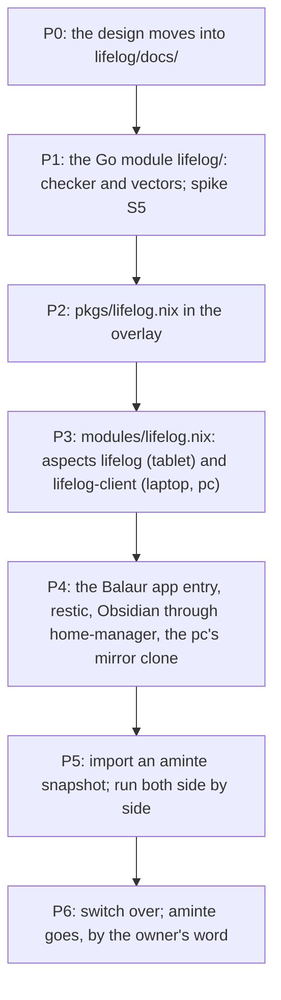
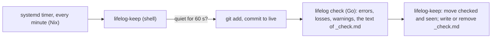

# Plan 002 — lifelog in the Balaur fleet (2026-11-14)

lifelog started as a separate design repo (`balaur-life`) and moves into `balaur-fleet` as one of its core apps.
The fleet is its first consumer: the code, its package and its NixOS aspects change in one commit, and a push to
`main` deploys them. It is built next to aminte; aminte stays until lifelog works, as the fleet's AGENTS.md asks.



## Decisions (owner, 2026-11-14)

- The code and the design live in `balaur-fleet/lifelog/`, beside `camera/` and `gnome/`.
- The life folder is a Syncthing folder of its own, `balaur-life`, at `/srv/life`, readable by the owner only
  (group `lifelog`, 2770).
- It is on the tablet (the keeper), the laptop and the pc. There is no Windows machine.
- The first version integrates restic (through the `backup` aspect), the Balaur app (a `balaur.services` entry) and
  Obsidian (home-manager). There is no pi role in the first version.

## Who does what (owner, 2026-11-14)

Each part lives where the fleet already puts that kind of work. The Nix language evaluates once, at build time; it
cannot run while the machine runs, and it must never read `/srv/life`: whatever Nix reads goes into `/nix/store`,
which every user and the builders can read.

| part | language | what it does |
|---|---|---|
| configuration | Nix (`modules/lifelog.nix`) | the group, `/srv/life`, `.stignore`, the Syncthing folder, the keeper's user, service and timer, the git dir, restic's paths, the `balaur.services` entry, Obsidian, the pc's mirror fetch |
| the keeper | shell (`pkgs.writeShellApplication`), run by a systemd timer every minute | when no content file changed for 60 s: `git add -A`, `git commit` to `live`, `lifelog check`, move `checked` and `seen`, write or remove `_check.md` |
| the checker and the commands that write files | Go (`lifelog/`, standard library first) | `check` (the rules of design §6; it reads the whole tree each run, as spike S5 allows), `add`, `merge`, `rename-links`, `restore`, `import` |



## P0 — the design moves in

- `lifelog/docs/design.md` (fitted to the fleet), `plans/001-spikes.md` (the spikes so far), this plan.
- The fleet README lists `lifelog/`. No module changes, so no host's derivation changes.

## P1 — the Go module

- `lifelog/go.mod`, Go from the fleet's dev shell (`nix develop`). Standard library first. The one dependency is
  `golang.org/x/text` (Unicode NFC and case folding); the frontmatter has its own strict parser, not a YAML library.
- **Done (2026-11-14):** `lifelog check`, with every rule of design §6: the tree rules (`check/check.go`) and the
  rules that compare `seen` with `live` through git (`check/history.go`, with `-git-dir`). Spike S5 passed for both.
  The tests need the `git` program.
- The checker: the rules of design §6, with test vectors as files under `testdata/`. `lifelog check` prints the
  problems and the text of `_check.md`, and exits non-zero on an error or a loss; it never commits and never
  writes into the folder.
- The commands that write files: `add`, `merge`, `rename-links`, `restore`, `import`.
- There is no keeper loop in Go: the keeper is the shell script of P3.
- The importer is the only part that reads SQLite. Its dependency (`modernc.org/sqlite`, as aminte uses) stays out of
  the main binary: a command of its own, or a module of its own.
- Spike S5 (scale) runs here: a synthetic fifty-year tree and the time of a whole-tree check, cold and warm.

## P2 — the package

- `pkgs/lifelog.nix` (`buildGoModule`, `CGO_ENABLED=0`, its tests in `doCheck`), in the overlay of
  `modules/flake/packages.nix`.
- **Done (2026-11-14):** it builds, and its tests run in the build sandbox (`git` in `nativeCheckInputs`).

## P3 — the aspects

- `lifelog` (tablet): the group, `/srv/life`, the Syncthing folder, and the keeper: `lifelog-keep`, a
  `writeShellApplication` with `git`, `coreutils`, `findutils`, `gnugrep` and `lifelog` as its `runtimeInputs`, run
  as a oneshot service by a timer every minute (a system user in the group `lifelog`, the git dir in
  `StateDirectory`, hardening, no network).
- `lifelog-client` (laptop, pc): the group with the owner in it, `/srv/life`, the Syncthing folder, the CLI.
- Both read the registry for the peers, like `files.nix`, and work without the `files` aspect. The Syncthing
  folder's ignore list is declared (`ignorePatterns`), so no `.stignore` is written by hand.
- **Done (2026-11-14), not deployed:** `modules/lifelog.nix`; the tablet lists `lifelog`, the laptop and the pc
  `lifelog-client`. All three hosts evaluate and build. The closure diffs hold only lifelog's parts (the keeper's
  units on the tablet; Obsidian and Electron on the laptop and the pc; the mirror's units on the pc).
- **The keeper, exercised:** the built `lifelog-keep`, with its two paths and its quiet time changed, ran through a
  scenario on a synthetic folder (first run, an error, an acknowledgement that does not clear an error, a fix, a
  loss, no new check without a change, the acknowledgement of a loss, a change inside the quiet window). Each step
  moved the refs and wrote or removed `_check.md` as design §4 says. The first run found a bug that the build did
  not: `git init --bare` refuses to run while `GIT_WORK_TREE` is set; the script now creates the git dir first.
- **Not yet seen on the tablet:** the keeper under systemd (its user, its hardening, the group's permissions), and
  the time of a check on the tablet's CPU.

## P4 — integrations

- `balaur.services`: an entry for the keeper's timer (no web UI).
- `backup.nix`: `/var/lib/lifelog/life.git` when the machine has `lifelog`. The `backup` aspect itself waits for
  the owner's repository (handoff item 1).
- Obsidian through home-manager on the laptop and the pc. The owner opens `/srv/life` as a vault once: Obsidian
  rewrites its own list of vaults, so the aspect does not declare it.
- The pc: `lifelog-mirror`, a nightly `git clone --mirror` / `remote update` of the history from the tablet over
  SSH, as the owner, into `~/.local/share/lifelog/life.git`. It needs the owner's SSH key on the pc to reach the
  tablet without a passphrase prompt; that is not checked yet.
- **Done (2026-11-14), not deployed**, in the same change as P3.

## P5, P6 — import and switch

- The importer reads the `life-latest.db` that the `aminte` aspect publishes. Both run side by side until the owner
  says lifelog works. Then aminte's aspects, package and flake input go in one commit.
- **The importer, done (2026-11-14):** `lifelog-import`, a second binary of the package, so that its SQLite
  dependency (`modernc.org/sqlite`, pure Go) stays out of `lifelog`. It opens the snapshot with `mode=ro` and
  `immutable=1` (no lock, no `-wal`, no `-shm`), refuses a folder that is not empty or a git dir that exists, builds
  `live` with `git fast-import` (design §8), checks it out into the folder, and prints a report of what it renamed
  or left out. Tested on a synthetic snapshot (`cmd/lifelog-import/testdata/snapshot.sql`), and once by hand on a
  synthetic database made with aminte's real `docs/schema/schema.sql` (its CHECKs and triggers accepted the rows;
  aminte's seeded metric Mood came through; `lifelog check` found no problem in the result). It has not read the
  owner's data.

### The deploy (2026-11-14, commit f122baa)

- The tablet and the pc run it, with no failed unit; the laptop was asleep and follows when it wakes.
- Tablet: `lifelog-keeper.timer` runs every minute and each run finishes; the first run created the git dir and
  the first state, with `live`, `checked` and `seen` on it. `/srv/life` is `syncthing:lifelog`, 2770. The owner
  reads the keeper's history (`git log` works through the system's `safe.directory`).
- Syncthing: the pc and the tablet added the folder `balaur-life` and exchanged indexes.
- pc: `lifelog`, `lifelog-import` and Obsidian are installed; `lifelog check /srv/life` passes in a session that
  has the group `lifelog` (a session that started before the deploy has the old groups: log in again). The mirror,
  run once by hand, cloned the tablet's history over SSH with no prompt; its timer runs at 04:07.
- Not yet seen: the laptop; the time of a check on the tablet's CPU at a real size (after P5).

### P5, step by step (needs the owner's word: it reads the real snapshot)

After the deploy, on the tablet, as the owner. The import goes to a private folder first, because what the
importer writes has the owner's umask.

```sh
sudo systemctl stop lifelog-keeper.timer
install -d -m 0700 ~/lifelog-import
lifelog-import -db /srv/files/shared/aminte/life-latest.db \
  -folder ~/lifelog-import/life -git-dir ~/lifelog-import/life.git > ~/lifelog-import/report.md
lifelog check ~/lifelog-import/life          # read the report and the problems first
sudo rm -rf /var/lib/lifelog/life.git /var/lib/lifelog/reported /var/lib/lifelog/last-run
sudo cp -a ~/lifelog-import/life.git /var/lib/lifelog/life.git
sudo chown -R lifelog:lifelog /var/lib/lifelog/life.git && sudo chmod -R g+rX,o-rwx /var/lib/lifelog/life.git
# -R, not -a: -a copies the owner, group and mode too, of the folder itself as well,
# and locks the keeper and Syncthing (both in the group lifelog) out of /srv/life.
cp -R ~/lifelog-import/life/. /srv/life/      # Syncthing brings it to the laptop and the pc
find /srv/life -user "$USER" -type f -exec chmod 0660 {} +
sudo systemctl start lifelog-keeper.timer
journalctl -u lifelog-keeper -f              # the first check; then rm -rf ~/lifelog-import
```

The keeper finds the folder equal to the tip of `live`, so it commits nothing new. Its first check has no `seen`:
with no error and no loss it moves `checked` to the imported state; it sets `seen` too when there is nothing to
report, and otherwise when the owner deletes `_check.md`.

### P5, the run (2026-11-14)

- The import of the snapshot of 2026-11-14 03:17 took 1.05 s on the tablet; the snapshot got no `-wal` or `-shm`.
  1 894 pages, 271 tombstoned pages, 336 files of readings, 2 437 commits.
- The first `lifelog check` of the import found 40 line-endings errors (pages with CRLF in part of their text);
  the importer now writes LF only (44 pages changed). The second import checked with exit 0 and 8 warnings: Mood
  readings with several values on one day from one source and with no time.
- The install step `cp -a` (as this plan first said) made `/srv/life` and its files `alex:users`, mode 0750; the
  keeper and Syncthing stopped on their own safety checks, and nothing synced or was committed. Fixed by hand
  (group `lifelog`, 2770 and 0660), and the step above is corrected. Syncthing on the tablet stayed in its error
  state until a restart.
- After the fix: the keeper committed nothing new, moved `checked` to the import, and wrote `_check.md` with the
  8 warnings. A keeper run took 176 ms.
