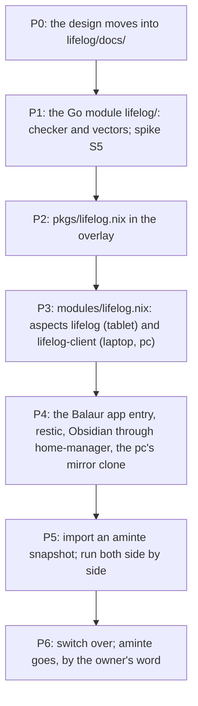

# Plan 002 — lifelog in the Balaur fleet (2026-11-14)

lifelog started as a separate design repo (`balaur-life`) and moves into `balaur-fleet` as one of its core apps.
The fleet is its first consumer: the code, its package and its NixOS aspects change in one commit, and a push to
`main` deploys them. It is built next to aminte; aminte stays until lifelog works, as the fleet's AGENTS.md asks.

## Decisions (owner, 2026-11-14)

- The code and the design live in `balaur-fleet/lifelog/`, beside `camera/` and `gnome/`.
- The life folder is a Syncthing folder of its own, `balaur-life`, at `/srv/life`, readable by the owner only
  (group `lifelog`, 2770).
- It is on the tablet (the keeper), the laptop and the pc. There is no Windows machine.
- The first version integrates restic (through the `backup` aspect), the Balaur app (a `balaur.services` entry) and
  Obsidian (home-manager). There is no pi role in the first version.

## P0 — the design moves in

- `lifelog/docs/design.md` (fitted to the fleet), `plans/001-spikes.md` (the spikes so far), this plan.
- The fleet README lists `lifelog/`. No module changes, so no host's derivation changes.

## P1 — the Go module

- `lifelog/go.mod`, Go from the fleet's dev shell (`nix develop`). Standard library first; a YAML parser is the one
  dependency that may earn its place (frontmatter), and it is argued in the commit that adds it.
- Packages: the checker (rules of design §6, with test vectors as files under `testdata/`), the keeper loop, the
  CLI (`add`, `merge`, `rename-links`, `restore`, `check`), the importer.
- Spike S5 (scale) runs here: a synthetic fifty-year tree and the time of a whole-tree check, cold and warm.

## P2 — the package

- `pkgs/lifelog.nix` (`buildGoModule`, `CGO_ENABLED=0`, its tests in `doCheck`), in the overlay of
  `modules/flake/packages.nix`.

## P3 — the aspects

- `lifelog` (tablet): the group, `/srv/life`, the Syncthing folder, the keeper service (a system user, the git dir
  in `StateDirectory`, hardening), `.stignore`.
- `lifelog-client` (laptop, pc): the group with the owner in it, `/srv/life`, the Syncthing folder, the CLI,
  `.stignore`.
- Both read the registry for the peers, like `files.nix`, and work without the `files` aspect.

## P4 — integrations

- `balaur.services`: an entry for the keeper unit (no web UI).
- `backup.nix`: `/var/lib/lifelog/life.git` when the machine has `lifelog`. The `backup` aspect itself waits for
  the owner's repository (handoff item 1).
- Obsidian through home-manager on the laptop and the pc, with its vault on `/srv/life`.
- The pc: a nightly `git fetch` of `life.git` from the tablet into a mirror clone.

## P5, P6 — import and switch

- The importer reads the `life-latest.db` that the `aminte` aspect publishes. Both run side by side until the owner
  says lifelog works. Then aminte's aspects, package and flake input go in one commit.
