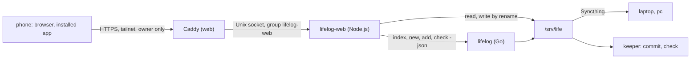

# Plan 003 — the web app (2026-11-15)

The owner reads and writes the life folder from the phone. Obsidian stays the editor on the laptop and the pc. The
phone gets no copy of the folder: it opens a web app that runs on the tablet, next to `/srv/life`.

## Decisions (owner, 2026-11-15)

- It runs on the tablet, at `https://life.<domain>`, for the owner's devices only (Caddy's owner gate, as for every
  owner service). It has no login of its own.
- The first version: the journal and the pages (read, edit, create, links, backlinks), the readings (add one, a
  chart of each metric), and search.
- Node.js, server-rendered HTML, with htmx for small updates. The editor is a plain text area: it works best with
  a phone's keyboard.
- It installs as an app on the phone (a web manifest and a service worker). A note or a reading added offline waits
  on the phone and is sent when the phone reaches the tailnet again. Reading and editing pages needs the tablet.

## Who does what

The rules have one home: the Go checker. The web app draws the folder and writes into it; it never decides what
is valid.

| part | language | what it does |
|---|---|---|
| `lifelog index` | Go | each page's title, aliases, properties and resolved links, and each metric, as JSON: the title key and the link grammar stay in Go |
| `lifelog new` | Go | creates a page; refuses what the checker would find in error, and a title another page holds |
| `lifelog add` | Go | appends a reading to the CSV of the machine `web` (`metrics/<m>/<year>.web.csv`) |
| `lifelog check -json` | Go | the problems, which the app shows for a page after it saves it |
| `lifelog/web/` | Node.js | the pages, the editor, the save (with a check that nobody changed the file meanwhile), the note added to a day page, search, the charts, the service worker |

## Guardrails

- **A Unix socket, not a port.** The tablet is shared with a second person, and a loopback port is open to every
  local account. The socket's folder belongs to the group `lifelog-web`, which holds only Caddy. The service has
  no network at all (`PrivateNetwork`).
- **A save never overwrites a change it did not see.** The editor sends the SHA-256 of the text it opened; a file
  that changed since (Obsidian, Syncthing) refuses the save (409) and shows both texts.
- **Writes are atomic**, as the Go commands write: a temporary file named `.syncthing.<name>.*.tmp`, then a rename.
  The browser sends CRLF from a text area; the app writes LF.
- **A capture is applied once.** Each note or reading from the phone has an id; the app keeps the ids it applied
  in its state folder, so a resend after a lost answer does nothing.
- **A request from another site is refused** (its `Origin` or `Sec-Fetch-Site`).
- The app logs no path, title or text: only the route, the status and the time.

## Steps

- **W1:** the Go commands `index`, `new` and `check -json`, with tests.
- **W2:** `lifelog/web/`: the app and its tests (`node --test`), run against the real `lifelog` binary.
- **W3:** `pkgs/lifelog-web.nix` (`buildNpmPackage`, its tests in the build), the service in the `lifelog` aspect,
  and a `socket` for `balaur.services`, which `web` proxies to.
- **W4:** deploy; the owner opens `https://life.<domain>` on the phone and installs it.

## The deploy (2026-11-15, commit b8f35fd)

- The tablet and the pc run it, with no failed unit; the laptop was asleep.
- `https://life.balaur.space` answers the pc (200) and refuses the tablet's own screen (403). systemd made the
  socket `root:caddy`, 0660, and started the app on the first request.
- On the real folder, each view answers in 0.04–0.11 s; a search over every page in 0.4 s.
  `systemd-analyze security lifelog-web.service`: 2.9 (OK). The app logged no error.
- The desktop: the laptop and the pc open the same address in a browser.
- Not seen yet: the phone (installing it, the offline queue).
