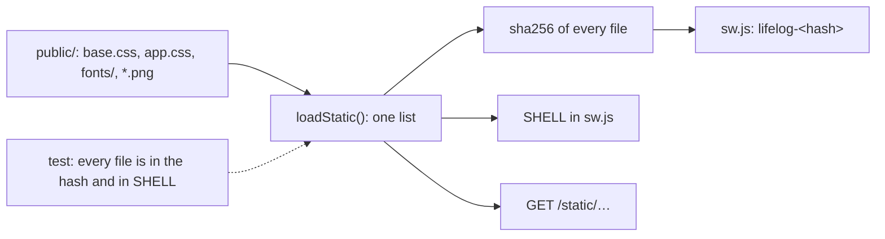

# Plan 004 — the Almanac look (2026-11-15)

lifelog-web gets the look and the UI patterns of aminte's browser: the Almanac, bound in Hearthwood (oak, parchment,
wood, ink, pixel art). The source is `~/Projects/aminte/extensions/web/` (README, "The shell and the look" and "The
sheets, the faces and the pictures"; `view/html/base.css`, `app.css`, the templates; aminte plans 092–149). aminte is
retired and its repo stays as it is.

This changes the presentation only. The architecture and the guardrails of [plan 003](003-the-web-app.md) stay:
the rules are Go's, the save that refuses a changed file (409), atomic writes, LF, contained paths, the same-origin
check, no raw HTML from a page, logs with no path or text, the socket and its sandbox, the offline queue and the
service worker, and the Content-Security-Policy (`style-src 'self'`, no inline style or script).

## What comes from aminte

| part | how |
|---|---|
| the tokens and `base.css` (by element, four layers, logical properties, `light-dark()`) | copied, the font URLs changed to `/static/fonts/` |
| `app.css` (the shell, rows, panels, toast, alert, `.wikilink`, `.chart`) | the parts lifelog uses, rewritten for its views |
| the three faces (OFL 1.1) and their licences | copied to `public/fonts/`, with their README |
| the pictures (wood, ground, embers, sprites, icons) and the app icons | copied as static files, with a README that points to aminte's `pixelart/` |
| the contrast test (4.5:1 text, 3:1 edges and focus, both themes) | ported to `node --test` |

What does not come: the login and the lock (Caddy's gate is the door), the Siren generic view and the catalog, and
the Go drawing code of the pictures.

## Serving the sheets

aminte puts its sheets into `<style>` elements. lifelog-web serves every file under `/static/`, so the CSP stays as
it is. Each new file goes into the hash that names the service worker's cache, and into its shell list, so the phone
never keeps an old file and `/capture` draws right from the cache alone. A test holds this.

## The shell

- 900 px and wider: the rail of wood on the left (the brand and today's date, Search, New, Today, Pages, Metrics,
  Capture), the page as a slab of oak beside it.
- Under 900 px: a top bar (the brand, the date, Search, New) and a bottom bar (Today, Pages, Metrics, Capture).
  Controls are 44 px high.
- The offline queue (`#queue`) stays in the shell, as a quiet strip under the top bar.

## The owner's decisions

Decided on 2026-11-15.

- **The period views are in this plan** (step A5): the week, the month and the year, read from the journal pages
  and the `day:` properties that `lifelog index` gives. The stream of aminte stays out.
- **One ground: the boards.** No settings page and no animated ground (firelight, embers): lean on the CPU and the
  phone's battery. `embers.png` is not copied.
- **The pictures are copied as PNG files**, with the app icons, into `public/`. A README beside them names
  aminte's `pixelart/` as their source. The Go drawing code is not ported. Only the pictures that a sheet uses are
  copied.
- **A write's result is a toast; a problem is an alert.** "Saved." is a toast at the top of the page (a
  `<dialog open>` with a Close form, so it needs no script). The checker's problems, the 409 conflict and a
  refused new page are alerts (`role=alert`) in the page.

## Steps

Each step is one commit, checked (`nix flake check --no-build`, `nix fmt`, `nix build .#lifelog-web`, a build of
the tablet) and pushed only with the owner's yes.

- **A1:** the tokens, `base.css`, the fonts; the static list, the service worker's shell and its test; the
  contrast test.
- **A2:** the shell (the rail, the phone's bars), the day view, the page view.
- **A3:** browse, search, metrics and the chart, the forms, the editor, capture; the toast and the alert.
- **A4:** check on the phone and the desktop; deploy; record the deploy here.
- **A5:** the week, the month and the year, in the new look, with tests.

## The periods (A5)

`/week/2026-W46` (an ISO week, Monday first), `/month/2026-11` and `/year/2026`; `/calendar` opens this month.
Calendar is a section of the rail and of the phone's bottom bar. The day's leaf opens its month, and the line under
the weekday links its week. `src/periods.js` holds the date logic, with its tests (every day of five years is in
the week that its days list).

| view | what each day shows |
|---|---|
| week | the weekday and the date, the first line of the journal page, the pages dated that day (`day:`), the readings |
| month | a cell: the day's number, tinted when written, its first line and its count of dated pages; today framed |
| year | twelve small months: a written day tinted, today framed |

## The deploy (2026-11-15)

- **A1** (commit 612479b): the tablet ran it in 24e2288 with no failed unit. `https://life.balaur.space/`
  answered the pc 303. The new `base.css` and the faces were served; a face had `Cache-Control: public,
  max-age=31536000, immutable`. `journalctl -u lifelog-web -p err` was empty.
- **A2 and A3** (b853a8b, 8838299): the tablet ran 8838299 with no failed unit; the root answered 303 and the day
  answered 200 with the new shell; no error in the journal.
- Found on the way: the service worker serves `/static/` from its cache first, so the first page after an update
  was drawn with the old sheet. Since A3, `app.js` loads the page again once when a new worker takes over, but not
  while a field holds text.
- Found on the way: the build reads the files that git tracks, so a new file must be added to git before
  `nix build .#lifelog-web` sees it. The test of the static files then fails, as it should.
- **A4 is open:** the owner looks at it on the phone and the desktop.
