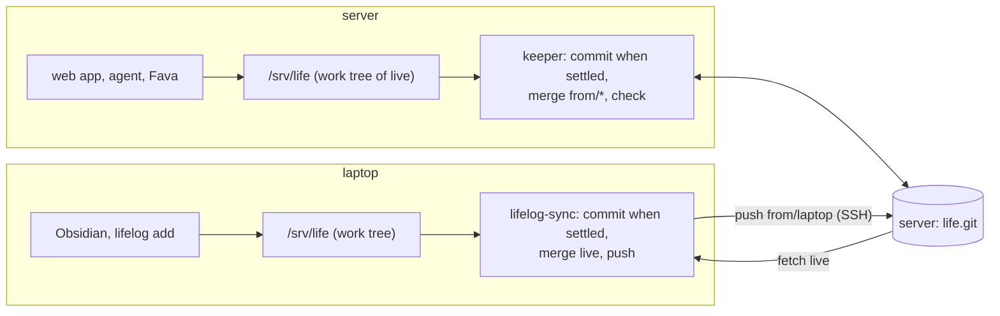
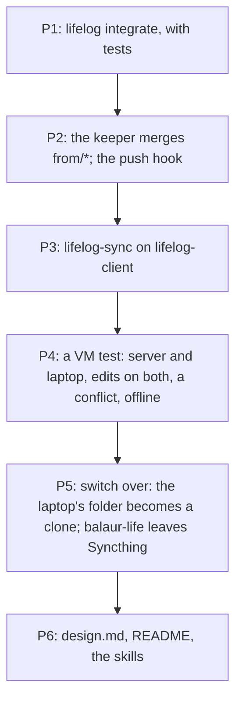

# Plan 005 — the life folder syncs through git (2026-11-21)

Syncthing carries `/srv/life` between the server and the laptop today (design §3). This plan replaces it with git:
the keeper's history, `life.git` on the server, becomes the hub that the laptop pulls from and pushes to. It is
built next to Syncthing and proven in a VM test first; Syncthing's `balaur-life` folder goes only at the switch-over
(P5), as the fleet's AGENTS.md asks. The `files` folder (`files.nix`) is another plan's (phase 4 of the move to
Forgejo).

**Why.** One sync mechanism fewer, with no daemon and no second view of the folder: the history that already records
every state also carries it. Each commit then says which machine made it and when that machine settled (design §7
records only when the server settled), and an offline week arrives as that week's commits, not as one.

**Why not Forgejo.** The life folder is health data and private notes. Forgejo would index it and keep a copy in its
own state; plain git over SSH to `life.git` keeps it where it is, readable by the group `lifelog` only. Forgejo also
cannot hold a repository with a work tree, and the server's folder is one.

## The model

- **Refs.** `live`, `checked` and `seen` stay as they are, and only the keeper moves them. Each other machine pushes
  to one ref of its own, `from/<host>`. A hook on `life.git` refuses any other push, so a client can never move
  `live` under the server's folder.
- **The keeper (server), each minute.** As today, it commits the settled folder to `live`. Then, for each `from/<host>`
  that `live` does not contain, it merges that ref into `live` and into the folder. Then it checks, as today.
- **The client (laptop), each minute.** `lifelog-sync` commits the settled folder to its own branch, fetches,
  merges `live` into it, and pushes it to `from/<host>`. Offline, it commits and stops; the push goes at the next
  run with a network. Its commits carry the machine's name (`lifelog laptop`).
- **One merge rule, in Go.** A new command, `lifelog integrate <ref>`, does both sides' merges, so the rule lives in
  one place, with tests:
  - What git merges cleanly is merged. Per-machine CSVs (design §2) mean readings never conflict.
  - A file both sides changed: the version already in the folder stays, and the other side's goes beside it as
    `<name>.sync-conflict-<host>-<time>.<ext>`. The checker already reports such a file as an error, and
    `lifelog merge` already merges a CSV copy (design §5). Nothing refuses a write and nothing is lost.
  - A file one side deleted and the other changed: the changed one stays. The checker reports a loss only for what
    is really gone.
- **`_check.md`** is committed by the keeper, so it reaches the laptop through `live`. Deleting it on any machine is
  still the acknowledgement: the deletion arrives in the server's folder by the merge, and the keeper's existing rule
  (`_check.md` gone where it wrote one) moves `seen`.
- **Settled** keeps its meaning on each machine: no change in the content folders for 60 seconds. The keeper merges
  only into a settled folder, and a write that lands during a merge makes git refuse the merge; it is tried again at
  the next run.
- **Permissions.** `life.git` gets `core.sharedRepository = group`, so objects the owner pushes (as `alex`, in the
  group `lifelog`) stay writable by the keeper.

## Steps

| step | where | done when |
|---|---|---|
| P1 | `lifelog/cmd_integrate.go` | `go test` covers a clean merge, both sides editing one page, edit against delete, a binary file, a CSV per machine |
| P2 | `modules/lifelog.nix` (keeper) | deployed; with no `from/*` ref it does what it does today (the server's `live` keeps moving) |
| P3 | `modules/lifelog.nix` (`lifelog-client`) | the unit exists, but only runs against a folder that is a clone (none yet) |
| P4 | `modules/flake/tests.nix` | the test passes in `nix flake check`; it never touches the real folder |
| P5 | the laptop, by hand once | the laptop's `/srv/life` is moved aside, cloned from `live`, and compared with the old copy; Obsidian opens it; an edit on each side reaches the other |
| P6 | docs | design §1, §3, §4, §5, §7, §9, §11, §12 say git, not Syncthing |

## What changes for the owner

- Nothing in Obsidian, the web app or `lifelog add`.
- A laptop edit reaches the server one to two minutes after the typing stops (Syncthing: about a minute), and only
  while the laptop reaches the server.
- The nightly mirror clone on the laptop (`lifelog-mirror`) goes: the laptop's clone holds the whole history.
- A conflict copy is named `.sync-conflict-<host>-<time>` instead of Syncthing's device-id name.

## Accepted costs

- The keeper's merge writes into the server's folder while the web app or the agent may write there. Git refuses a
  merge over an unsaved change, so the cost is a retry, not a lost write.
- A client that never reaches the server holds its commits until it does; `balaur-fleet-status` does not show that
  yet.
- Deleted pages and old versions stay in git, on the laptop too (design §9 already accepts this for the server).
